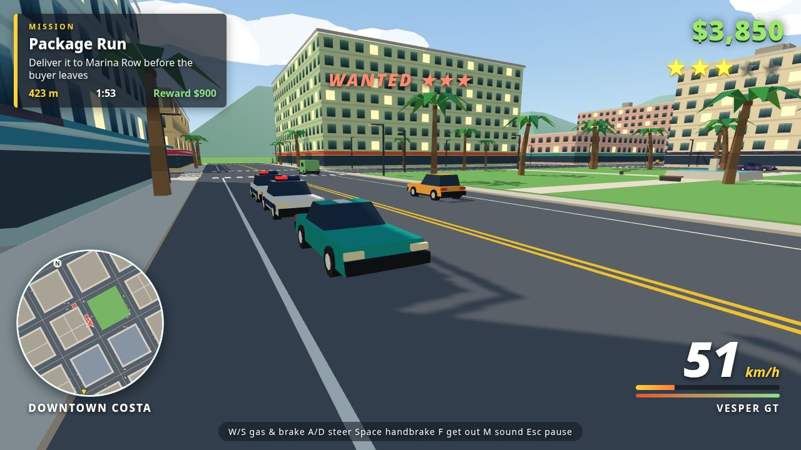

# SUNSET HARBOR

An original open-world crime-action game set in **Costa Serena**, a sunny harbor town. Everything you see and hear is generated by code at run time: the city, the cars, the people and the sound. There are no image, model or audio files.

Built with three.js (low-poly, flat-shaded) and plain ES modules. It runs offline from static files.

## How to play

Open `game/index.html` through any static server (`node serve.ts` serves it on http://localhost:8080) and press **Enter**.

| Key | Action |
| --- | --- |
| W A S D | walk / drive |
| Mouse | look (click the page to capture the pointer) |
| Shift | sprint |
| Space | jump / handbrake |
| F | get in or out of a car |
| M | mute / unmute sound |
| Esc or P | pause (the game saves) |

Take your Marlin and follow the mission marker. Steal other cars, but not in front of witnesses. Hit people or traffic and the police come after you; get away, or stop and you get busted.

## Systems

- **City**: seeded procedural road grid, blocks, buildings with lit windows, palms, street lamps, beach, pier and container yard, plus districts shown on the HUD.
- **Driving**: arcade car physics with grip, drift, handbrake, collisions and damage. Five car types and a police cruiser.
- **On foot**: walking, sprinting, jumping, getting in and out of any car, hijacking drivers.
- **Traffic**: 16 civilian cars that follow right-hand lanes, take turns at junctions and slow for cars and pedestrians. They respawn around you.
- **Pedestrians**: 28 people walk between sidewalk corners, wait before crossing and run from approaching cars.
- **Wanted level**: crimes add heat, which maps to one to five stars. Get out of sight of the police and the stars wear off.
- **Police**: cruisers spawn by star level, chase along the road graph, ram you and arrest you when you are slow and surrounded.
- **Missions**: six scripted jobs (reach, delivery, car theft, escape) and then endless Courier Jobs, with timers, rewards and map markers.
- **Save / load**: progress is stored in `localStorage`; damaged data is ignored.
- **Sound**: engine, tyre roar, siren, crashes, doors, mission, busted and wasted stings, waves and birds, all synthesized with WebAudio.
- **HUD**: mission panel, cash, stars, speedometer, car condition and a rotating circular minimap.

## Technical layout

All game code lives in `game/src/`, one responsibility per file.

| Area | Files |
| --- | --- |
| Boot and loop | `main.js`, `ui.js`, `input.js`, `bench.js`, `shots.js` |
| World data | `config.js`, `rng.js`, `cityLayout.js`, `roadNet.js` |
| Rendering | `meshBuilder.js`, `textures.js`, `cityBuilder.js`, `scenery.js`, `environment.js`, `cameraRig.js` |
| Simulation | `world.js`, `collision.js`, `vehicles.js`, `vehicleModels.js`, `roadDriver.js`, `traffic.js`, `pedestrians.js`, `characters.js`, `player.js` |
| Gameplay | `wanted.js`, `police.js`, `missions.js`, `save.js` |
| Interface | `hud.js`, `minimap.js`, `audio.js` |

Static city geometry is merged into a handful of meshes with vertex colors. Cars are culled by distance and drop their wheel meshes at range to keep draw calls low.

## Tools

- `node serve.ts`: local static server.
- `node scripts/shoot.mjs`: deterministic screenshots from `?shot=start|drive|chase|walk`.
- `node scripts/perf.mjs [seconds] [width] [height]`: autopilot drive with a three-star chase (`?bench=1`) that reports frame time and draw calls.

## Credits

three.js (MIT) is vendored in `game/vendor/`; see `game/CREDITS.md`. Costa Serena, its cars, people and brands are invented for this project.
